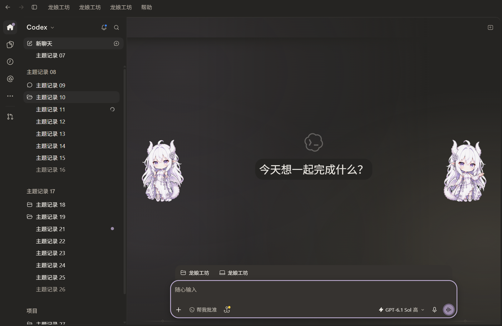
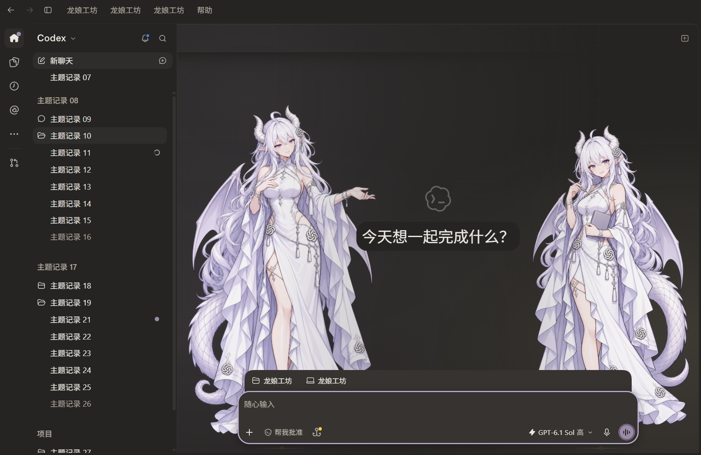
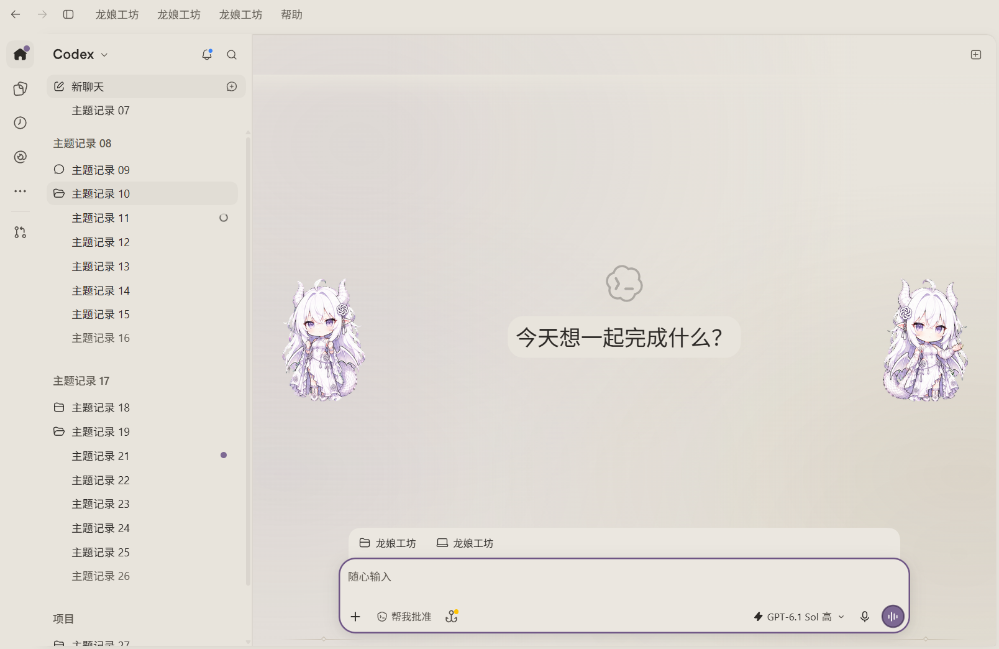
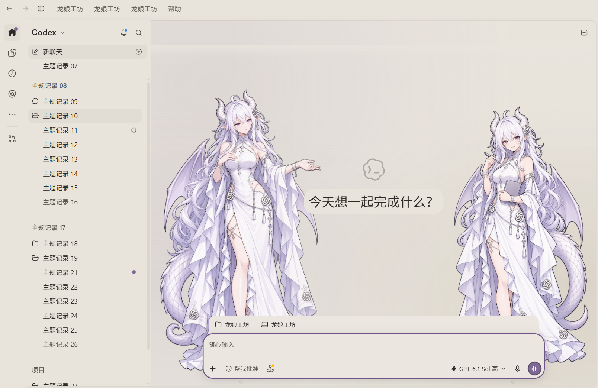

# Codex Dragon Atelier · 龙娘工坊

现代简约、克制典雅的 GPT 白发龙娘主题。暖灰石与纸感底色搭配少量雾紫、哑金；明暗是亮度模式，不限定纯黑和纯白。DSH Maid Atelier 提供完整度与层次的参考，正常立绘采用年轻成年/成熟成年两种气质，参考自然体型差异与相向陪伴；Q 版保留原作双姿态。

**v0.1.0-beta.3 · Windows Store Codex 26.1002.6548.0。** [Windows 预发布下载](https://github.com/NoelCornel/Codex-Dragon-Atelier/releases/tag/v0.1.0-beta.3)。这是独立、非官方项目，未获 OpenAI 官方授权或背书。

| Full Q 全量背景 | Full Portrait 全量立绘 |
|---|---|
|  |  |
|  |  |

Q 素材：fywdy，原设 ZipZipPipe。正常版为本项目参考 ZipZipPipe 原设与 ApprenTice 改编生成的透明衍生立绘。原图、来源及提示词均保留，新生成 Q 候选已撤回。[来源、署名与各素材许可](NOTICE.md)。

## 版本选择与安装

1. 下载并核对 Release 的 SHA256SUMS，解压到固定目录。全量版需要 Node.js 22+ 与 Microsoft Store Codex；本机验证为 Node 24.16.0。
2. 在 Codex「设置 → 外观」先复制自己的原明暗主题分享码，便于恢复。
3. **Lite 轻量配色**：运行「复制轻量版配色.cmd」，选择明色或暗色，将复制的分享码粘贴到官方相应主题导入框。分别导入两种模式即可。也可直接复制 `dist/native-dark.txt` 与 `dist/native-light.txt`。Lite 没有人物、渐层或后台观察进程，细部状态由官方客户端派生。
4. **Full Q**：导入相同两份配色后，双击「启动Q版背景.cmd」。原版 Q 双姿态沿聊天区水平中部布置，保持同等大小并避开输入框。单格192×208，按屏幕 DPR 限制不放大；125%时最大153.6 CSS px，因此比旧放大展示更小，不能靠插值恢复缺失细节。
5. **Full Portrait**：导入相同配色后，双击「启动立绘背景.cmd」。成熟成年在左、年轻成年在右，相向手势、共同落脚，右高度为左 .94，不机械做成巨人/小人。使用两张941×1672生成衍生图。默认「启动龙娘工坊.cmd」启动 Q 版。

全量版还提供容器、文字层级、菜单、代码块、链接、输入焦点、按钮状态和背景材质的完整色表。字体家族、字号、字重和行高保留用户原生设置。三种选择共用 `src/tokens.json`，由同一源码构建。[完整能力与实施对照](docs/主题实施对照.md)。

全量版启动一个独立配置的官方客户端，默认仅在 127.0.0.1:9445 开放本机 CDP。独立配置可能需要登录；普通已打开的 Codex 窗口不会自动获得背景。端口被其他应用占用时停止启动，可用 `powershell -File scripts/Launch.ps1 -Port 9446 -Edition portrait` 选择空闲端口。

## 行为与恢复

- 静态人物舞台是聊天主面板的首个子节点，绝对定位、z-index:0、inert、pointer-events:none。输入和菜单在前，人物不能点击或接收焦点，没有跨应用置顶层。
- 对话页人物减弱，消息背景保留阅读保护层。聊天区小于 700px 或高度不超过 420px 时隐藏人物，侧面工作区挤占也会触发。Q 版空间不足时进一步隐藏。
- 跟随官方明暗模式。设置页保持配色并隐藏人物；系统高对比度模式交还原生配色并隐藏人物。两种人物版本都没有动画。
- 切换版本会核验并替换本项目自己的观察进程。双击「恢复装饰.cmd」停止该进程并移除全量样式与人物；官方导入颜色保留，恢复原配色需导入第 2 步保存的分享码。
- 「记录窗口遮挡.cmd」「解除开屏遮挡.cmd」用于独立的历史开屏遮挡排查，不是主题必要组件。[取证与恢复说明](docs/WINDOW_RECOVERY.md)。

不修改 WindowsApps、官方 app.asar、模型或额度挂件的用户数据，不发送聊天。请避免同时使用两个完整样式注入器。缺失可见锚点或未来客户端采用不支持的定位结构时，全量装饰自动退出；未知版本与平台未验证。

## 指导文件与开发

用户授权的本机 Wawazz / `claude-opus-5-5` 指导已保存正文；最新长回复截断的 H 色表另行补齐，原文与核验结果分别记录。返回模型标识来自转发服务，不等于底层身份的独立认证。

- [可读性与双角色实施指导](docs/可读性与双角色实施指导.md)：最新建议正文，含字体、完整色表与轮廓职责。
- [可读性修订实施记录](docs/可读性修订实施记录.md)：实际 DOM 原因、采用/纠正、撤回 Q 生成与分辨率限制。
- [完整主题指导模板](docs/完整主题指导模板.md)：模型全文，包含候选选择、完整职责与设计方法。
- [参考案例与配色候选](docs/参考案例与配色候选.md)：Radix、Fluent、Material 官方参考与自拟候选。
- [主题实施对照](docs/主题实施对照.md)：实际采用部分、对比度纠正、版本能力与未验证边界。
- [验证记录](docs/VALIDATION.md)：模拟检查与真实窗口验收分开记录。

```sh
node scripts/build.mjs
node --test tests/palette.test.mjs
python tests/browser-regression.py
node scripts/package.mjs
```

模拟回归需 Python Playwright 与 Chromium。`dist/` 由源码生成。发布包采用文件白名单，排除账号、私有评审请求、认证资料、用户配置及故障原始日志。

## 分支、发布与许可

`main` 保留首版公开基线；`theme/complete-atelier` 提供 beta.3 完整主题，`fix/background-stage-handoff` 保留 beta.2。旧 Release 不改写，所有版本均为预发布。

Dynamic Skin Manager 1.6.2 的[运行时资源漏打包修复](patches/README.md)保留为独立补丁；本机没有 .NET SDK，未重打包其 EXE。

原创代码 MIT；Q 素材 CC BY-NC 4.0；ApprenTice 立绘及其参考衍生立绘保留 CC BY-NC-SA 4.0 条件；ZipZipPipe 的 GPT 原设图遵循其第一方署名、非商业取用说明，不套用其 DeepSeek 角色许可。**代码 MIT 不覆盖立绘。** DSH 的鲸鱼角色图未复制，开屏视频未抽帧。素材级限制见 NOTICE。
