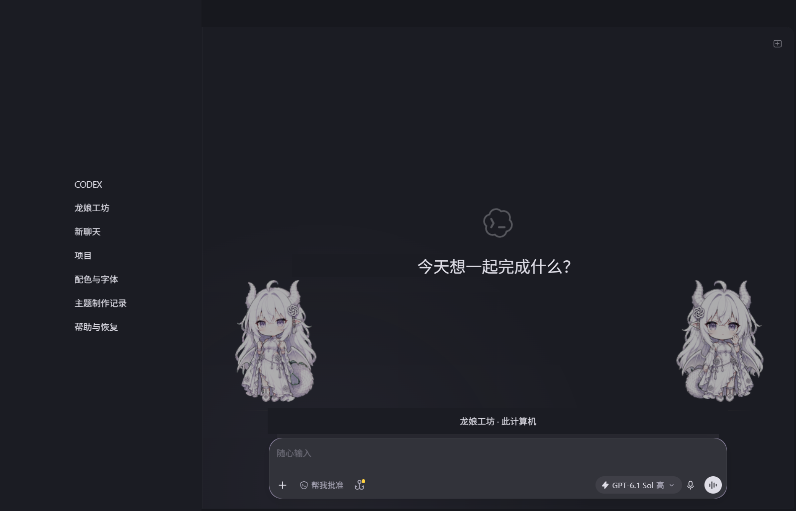
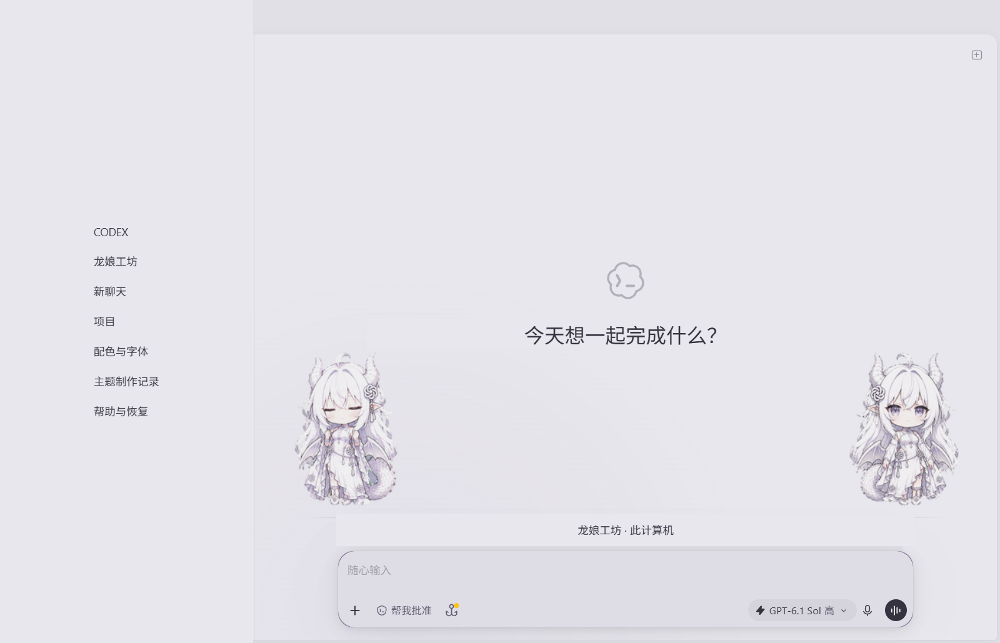

# Codex Dragon Atelier · 龙娘工坊

克制的明暗双主题，同一位 GPT 白发龙娘的 idle / waving 双姿态，陪伴原生 Codex 输入区。灵感来自 DSH Maid Atelier 的双角色构图；这是独立的非官方主题项目。

**v0.1.0-beta.1 · Windows Store Codex 26.1002.6548.0 实机验证。** 其他版本及平台尚未验证。配色使用官方主题导入；角色装饰使用可恢复的实验性本地 CDP 连接。




## 安装

1. 下载 Release 中的 Windows ZIP，核对同页 SHA256SUMS.txt，解压到长期使用的目录。需要 Node.js 22 或更高版本和 Microsoft Store 安装的 Codex。
2. 在 Codex「设置 → 外观」先复制、保存当前浅色和深色主题分享码，以便恢复。
3. 将 `dist/native-dark.txt`、`dist/native-light.txt` 的完整内容分别导入对应主题。颜色、字体偏好使用原生设置；不额外安装字体。
4. 双击「启动龙娘工坊.cmd」。它启动一个带本机调试端口的官方 Codex 窗口及隐藏的主题观察进程。必要时需要在该窗口重新登录。已有普通 Codex 窗口不会自动获得角色装饰。

端口默认 9445，仅连接 127.0.0.1。如果端口占用且不属于官方客户端，脚本会停止；可用 `powershell -File scripts/Launch.ps1 -Port 9446` 指定其他空闲端口。

## 体验与恢复

- 首页显示双姿态。会话页只在留白足够时显示较淡的角色，窄窗口自动隐藏；设置页不显示装饰。
- 保留系统/浅色/深色切换，原生字体、代码主题和输入区尺寸。红绿语义颜色与正文颜色分开。
- 装饰不可点击，不抢焦点。系统「减少动态效果」启用时改用静态图集帧。
- 双击「恢复装饰.cmd」停止本项目观察进程并移除本项目样式和角色；原生颜色保留。恢复颜色需导入之前保存的两个分享码。
- 不修改 WindowsApps、官方 app.asar 或模型配置，不发送聊天内容。状态日志只记录模式、布局和兼容性状态。

角色层只属于启动的 Codex 窗口，窗口隐藏时一同隐藏。它不是 GPT 娘额度挂件的替代品，也不修改其位置、大小、静音或语录。不要同时启用其他全窗口样式注入器。

## 开发与兼容性

```sh
node scripts/build.mjs
node --test tests/palette.test.mjs
python tests/browser-regression.py
```

浏览器回归需要 Python Playwright 和 Chromium。测试区分模拟页面与真实客户端，见 [验证记录](docs/VALIDATION.md)。构建产物在 `dist/`，Release ZIP 内含构建产物和源码；源码仓库不跟踪本机验收记录、个人设置和认证数据。

新版 Codex 会保留不可见的旧路由，本适配器只选取可见的原生节点；节点找不到时关闭装饰。兼容版本记录在 `src/adapter.json`，不能据此承诺未来更新必然兼容。

## 来源与发布方式

本项目使用独立仓库，`main` 为发布基线，`theme/dragon-atelier` 为主题分支，首版标签 `v0.1.0-beta.1`。采用 Beta 发布，是因为当前只完成一个 Windows 客户端版本的实机验证。

另附 Codex Dynamic Skin Manager 1.6.2 的 [资源打包修复补丁](patches/README.md)：补齐遗漏的运行时文件。它与主题分离，不包含重编译的管理器 EXE，不代表该上游已合入修复。

## 授权与署名

本项目原创代码使用 MIT；角色素材使用上游 CC BY-NC 4.0，禁止商业使用，须保留署名。原角色设计的取用条件及不同项目的许可证边界详见 [NOTICE](NOTICE.md) 和 [素材来源](assets/SOURCES.json)。**代码的 MIT 不覆盖角色素材或原设权利。**

灵感：Small-tailqwq / DSH Maid Atelier。GPT 白发龙娘原设：ZipZipPipe。Q 版素材：fywdy / chatgpt-chibi-pets。没有打包 DSH 的鲸娘素材。品牌名称用于说明适配目标；本项目未获 OpenAI 官方授权、赞助或背书。
